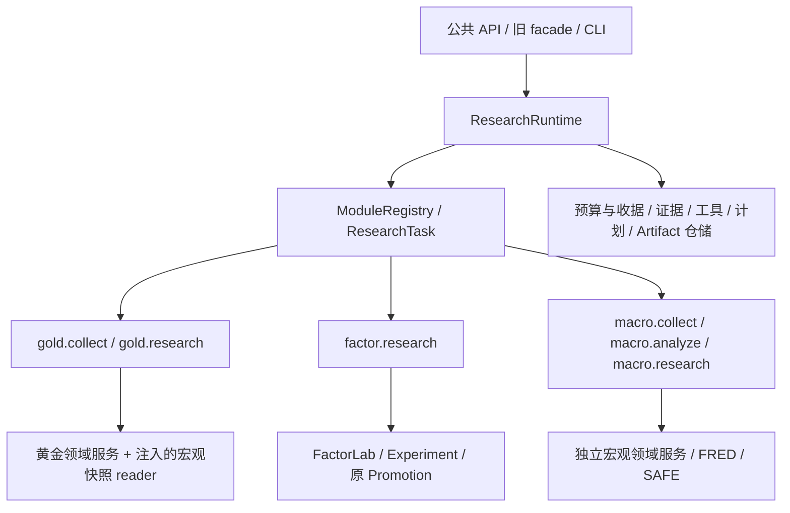

# Architecture

## 总体形态：Modular Monolith + Ports/Adapters

单进程单仓库，但保持严格的模块边界（见 ADR-0001）。领域层（`domain/`）不 import FastAPI、SQLAlchemy ORM、UI。所有外部依赖（数据源、券商、存储、任务系统）通过 `Protocol` 定义端口，注入适配器。

```text
Research -> Validation -> Strategy -> Deployment -> Execution
                                |             |             |             |
                                +-------------+-------------+-------------+
                                                            Global Risk Plane
```

- **Research Plane**：通用 ResearchRuntime、显式任务模块、Agent 提案、Factor DSL、FactorLab、Experiment/Artifact Registry。
- **Validation Plane**：上述研究结果仍须由确定性验证作业产生 `VALIDATION_REPORT`，不能由模型背书替代。
    PIT、OOS、walk-forward、purged CV/embargo、多重检验、中性化、成本/容量等是验证要求，
    不表示所有作业都已实现；落地程度以 [project_progress.md](project_progress.md) 为准。
- **Strategy Plane**：`Factor -> SignalSpec -> PortfolioConstructionSpec -> StrategyPackage`。
    因子只有到 `STRATEGY_ELIGIBLE` 才能被策略引用。
- **Deployment Plane**：`DRAFT -> BACKTESTED -> VALIDATED -> APPROVED -> PAPER -> SHADOW
    -> CANARY -> LIVE`。人工审批不可省略，运行时非 `RUNNING` 时不能激活。
- **Execution Plane**：共享策略逻辑，仅替换 clock、market data、broker 和 execution model。
    OMS 与 Execution Gateway 均执行安全门禁。
- **Global Risk Plane**：聚合股票与期货贡献，统一检查 NAV、gross/net exposure、margin、
    leverage 与 strategy allocation；各资产域仍保留自己的规则和账本。

股票与期货仍是独立 bounded context，不共享订单、持仓、账本或回放模型；但共享
`TradingRuntime`、KillSwitch、CapitalAllocator 和 PortfolioRiskControlPlane。

## 模块边界

| 模块 | 职责 | 依赖 |
|---|---|---|
| `domain` | 类型、枚举、领域模型、异常、JobRunner 协议 | 仅 pydantic |
| `artifacts` | 不可变 ArtifactEnvelope、Store、Registry、Lineage | domain, infra(持久化) |
| `data` | PITDataStore、Provider 协议、LocalParquetProvider、PIT Universe | domain |
| `rules` | MarketRuleBook 协议 + AShareRuleBook（configs/markets/cn_a.yaml 驱动） | domain |
| `backtest` | 事件驱动引擎、时钟、Feed、Exchange、Fill/Slippage/Fee、Ledger、EventStore、Replay | domain, rules, data, risk, execution |
| `risk` | 资产域 PreTradeRisk、PortfolioRiskControlPlane、CapitalAllocator、TradingRuntime、KillSwitch | domain |
| `execution` | OMS 状态机、BrokerGateway 协议、PaperBroker、Reconciliation | domain, risk |
| `futures` | 期货合约、双向持仓、保证金账本、Paper 仿真、回测、事件回放和 Gateway 端口 | artifacts, infra, risk |
| `research` 领域服务 | Experiment/Factor/Strategy 状态机、Scorecard、确定性 Promotion Policy | domain, artifacts |
| `research/runtime` | 通用任务契约、预算/收据、证据、计划、工具执行、运行仓储与调度 | domain, artifacts, agents 的配置/模型端口；不依赖金融模块 |
| `research/modules` | 显式注册的 gold/factor/macro 薄适配器 | runtime + 对应领域服务；组合根注入跨模块 reader |
| `agents` | 模型路由/网关、因子兼容编排与证据审议协议 | research, artifacts, backtest |
| `gold` | 黄金快照、独立手工配置、本地诊断、黄金审议与建议终审 | agents, runtime, artifacts, data, infra；不直接 import macro |
| `macro` | 独立宏观模型、FRED/SAFE 采集冻结、确定性分析 | artifacts, data, infra；不依赖黄金 |
| `api` | FastAPI 只读查询 + 少量控制端点 | 以上全部（组合根） |

## 关键数据流（每日）

```
Day T 18:30:  Tushare EOD → staging → quality gates → immutable DataSnapshot
              → deterministic MarketSnapshot → read-only API/Dashboard
Day T close:  verified snapshot → features → signal → PortfolioTarget
Day T+1:      generate orders → global + asset pretrade risk → OMS → gated gateway
              → PaperBroker/ExchangeSim
              → fills → ledger → PnL → reconciliation
```

质量失败只生成 `DATA_QUALITY_REPORT(FAILED)`，不会生成可供研究或交易使用的
`DATA_SNAPSHOT`。发布内容按哈希寻址，同一数据重复调度可幂等复用；源 staging 后续变化不会
影响已登记快照。市场摘要由结构化数据确定性计算，新闻或 LLM 不能覆盖行情事实，也不进入
交易路径。

严禁"用 T 收盘价生成信号又按 T 收盘价成交"。引擎断言 decision timestamp 在成交 bar 之前（见 docs/backtest_semantics.md）。

## 模块化研究运行时（2026-10-17）

已实现通用内核，而非仅有规划。入口在 API 组合根显式注册任务；内核通过 `ResearchTask`
调用领域适配器，不识别黄金方向、FactorLab 指标、Promotion 或页面。任务的角色是局部命名空间
字符串，经 `TaskDescriptor.roles` 映射到模型路由，不为每个模块扩大全局 `Literal`。



- `models/ports` 定义请求、计划、运行、结果、发布许可和显式注册契约；`engine` 管生命周期、两层任务树与协作取消。
- `calls` 是统一 `BudgetLedger/StructuredCaller`：根、子任务、planner、格式修复和终审共享记账，planner 历史仅结转一次并保留原始收据。调用前预留与存储意图，最多一次结构修复；受管网关无隐式传输重试，未知 usage 按预留保守结算，不承诺美元硬上限。
- `storage` 追加不可变 run/event/call/plan；事件每 run 连续编号，调用在 root 内统一稳定排序。启动恢复中断记录，不重放付费步骤；GET 不恢复写入。
- `evidence` 校验 hash、schema、父血缘与知识截止，区分 `FACT/DERIVED/OPINION`。`LATEST` 先采集再统一冻结截止；`HISTORICAL` 禁止现场采集，不自动认证历史 PIT。
- `planning` 只接受已注册任务、类型化输入引用、无环依赖与预算约束，最多6个计划节点，不允许子任务递归规划。规则规划不调用模型；可选模型规划计费、存档，须显式确认提交，修改已登记模型计划会被拒绝。
- `tools` 默认拒绝未注册或未授权工具，检查任务/角色 allowlist、capability、参数及调用前后 deadline。工具是可信 in-process 代码，不是网络/文件沙箱；取消不强杀线程，调用未退出不释放根槽。

单机、单 API worker：最多一个活动根任务、两个子任务并行，根模型并发最多三个，可由预算收紧。
根计划只确定性汇总子任务状态、摘要、报告引用与模块授权 hash；`Publication` 不授予部署权限，
根汇总不是新的投资建议模型门禁，也不能将子任务观点升级为事实或重发被拒绝建议。

领域政策仍各自拥有：黄金保留独立视角、有限修订、隔离终审与固定 `OBSERVE`/不部署；
因子保留单DSL候选、本地评估、双独立审查和原 Promotion。宏观独立采集/本地分析/双视角研究，
不产出投资建议；黄金只经注入 reader 读取冻结宏观事实。任务 YAML 配置仍在接线中，
目标仅映射角色、收紧预算与工具权限，不宣称配置接入已完成。

任务目录、新模块配方与四节点例子见 [research_modules.md](research_modules.md)；
调用与领域审议见 [multi_agent_llm.md](multi_agent_llm.md)，决策见
[ADR-0011](adr/0011-modular-research-runtime.md)。[ADR-0010](adr/0010-evidence-deliberation.md)
保留为黄金有限审议的历史决策。

## 持久化

- **PostgreSQL**（可降级 SQLite）：artifact 元数据、实验状态、订单/成交记录。SQLAlchemy Core/ORM + Alembic。
- **期货事件日志**：`futures_events` 是仿真账户的权威记录；`futures_simulations.snapshot` 是同事务更新的读取快照，加载时校验 hash chain 和事件头。
- **Parquet + PyArrow + DuckDB**：研究数据（行情、特征），PIT 字段随行存储。
- **本地文件系统 ArtifactStore**：内容按 `content_hash` 校验；字节/JSON 写入采用临时文件与硬链接原子发布，不覆盖已有目标，非文件/数据库跨资源事务。通用研究产物与故障语义见 [artifact_protocol.md](artifact_protocol.md)。

## 可观测性

结构化 JSON 日志（`observability/logging.py`），contextvar 绑定 `trace_id / experiment_id / backtest_run_id / strategy_id / order_id`。Metrics/Tracing 留有接口位，后续接 OpenTelemetry/Prometheus 不改领域代码。

## 未来演进路径

- 拆服务：模块边界即服务边界候选（data、backtest、execution 各自可独立）。
- JobRunner 协议已定义，`LocalJobRunner` 可替换为分布式任务系统而不动领域逻辑。
- Research Plane 已有模块化运行时与有限跨模块计划；分布式队列、沙箱、递归自治、自动晋级均未实现。扩大工具或自治范围前须有 Eval 证据，永不进入交易关键路径。

ADR 索引见 [adr/](adr/)。
