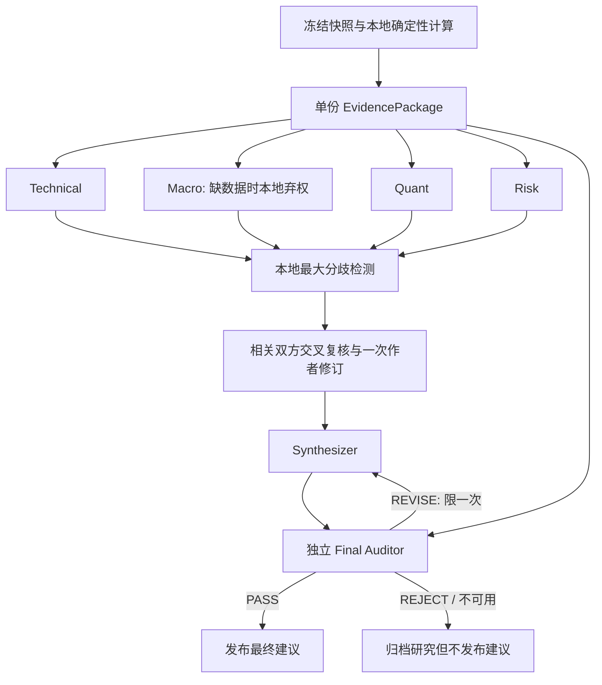

# 多智能体研究协议与配置

多智能体位于 Research Plane。模型服务不可用时，PIT 数据、回测、风控、OMS、账本和
PaperBroker 仍然独立运行。

## 运行时与调用（2026-10-17）

通用 `research/runtime` 已实现模型/端口、统一调用、Artifact 仓储、证据、计划、工具与引擎；
黄金、因子、宏观通过显式任务适配器使用它，不强行共享同一支团队或金融观点 schema。
黄金仍为 `gold-deliberation-v4`，因子仍为四角色，宏观有自己的两独立视角。
任务与 API 契约见 [research_modules.md](research_modules.md)，架构决策见
[ADR-0011](adr/0011-modular-research-runtime.md)，进度只维护在 [project_progress.md](project_progress.md)。

一个活动根任务、最多两个并行子任务、根模型并发最多三个。`BudgetLedger/StructuredCaller`
统一处理根、子任务、planner、格式修复、作者修订及终审；planner 的原始收据与用量执行时仅结转一次。
调用前原子预留、先存意图再发送，root 内稳定编号；结构化响应最多一次修复，修复独立计数。
受管网关单次传输，不做不可见连接重试；响应/usage 未知按预留保守结算，不按0计，
实际返回用量超估计仍如实入账并阻止后续调用。这不是美元硬限额或供应商 exactly-once。

角色属于任务：局部命名空间字符串通过 `TaskDescriptor.roles` 显式映射到模型 binding，
不为新模块修改全局角色 `Literal`。就绪检查仅涉及任务自己的路由和凭据。
规则规划不调用模型；可选模型规划存档后须显式确认执行，登记后内容改变会拒绝。
最多6个计划节点，不递归规划；根汇总是确定性子摘要与模块批准 hash，不新增投资建议模型门禁。

## 黄金领域协议



黄金有六个逻辑角色：技术、宏观、量化、风险、统筹、终审。首轮分析互不可见、受根并发上限约束；
技术、量化、风险共用固定参数的本地价格与诊断证据，不由研究员先选方向和参数。
`gold.collect` 采集后，`gold.research` 只研究指定冻结快照；可通过注入 reader 加入宏观事实，
不直接 import 宏观领域，也不读取宏观模型意见作为事实。证据不足时宏观本地
`INSUFFICIENT_EVIDENCE`、置信度0、不发模型请求；少量序列存在不等于黄金全部宏观要求已满足。

### 证据与观点

`agents/deliberation.py` 保留黄金有限审议的证据/观点契约，不是运行时的全局金融 schema：

- `EvidencePackage`：绑定 `snapshot_id/as_of`；`items` 只由本地代码创建，含定义、值、来源及缺口。
- `ResearchState`：`view/confidence/claims/risks/open_questions/invalidating_conditions/missing_evidence`。
- 每条 claim 引用 `evidence_ids` 和 `counterevidence_ids`，不能引用未知或空值事实；0和false不是缺失。
- `INSUFFICIENT_EVIDENCE` 是正常结果，必须列出缺失证据，自评置信度不超过0.4；它不是失败或中性的别名。
- 置信度只是模型自评，不是经过校准的胜率，也不做置信度投票或平均。

一份简化观点如下；模型不复制事实值：

```json
{
  "analyst": "technical_analyst",
  "view": "NEUTRAL",
  "confidence": 0.4,
  "summary": "价格趋势不能替代宏观与独立验证。",
  "claims": [{
    "claim": "当前中期价格证据不足以外推未来收益。",
    "evidence_ids": ["gold_return_126"],
    "counterevidence_ids": ["independent_oos"],
    "confidence": 0.4
  }],
  "risks": ["全样本诊断存在选择偏差。"],
  "open_questions": ["不同利率环境下是否仍成立？"],
  "invalidating_conditions": ["长期价格位置反转后复核。"],
  "missing_evidence": ["real_yield"]
}
```

### 有限审议与终审

分歧检测是本地确定性规则：优先方向跨度与双方置信度，其次方向与弃权之间的证据缺口、
同方向至少0.3的置信度差；每轮只选一个最大分歧 `D1`，不让模型再生成长篇群聊。
仅相关双方得到对方的结构化观点，各自一次质询与作者修订。原观点及修订均归档，不能覆盖。

没有新增证据时，整体或单条claim置信度不能提高；作者可维持、降置信度或明确撤回。
`evidence_requests` 只能请求已登记的证据ID，本版不自动联网补证、不在原快照内追加事实。
补数据必须另建快照再研究。修订后仍有分歧则 `UNRESOLVED`，预算不足则 `BUDGET_SKIPPED`，都不冒充共识。

终审使用不同于统筹的模型、新消息上下文，只见冻结事实、诊断限制和待审草案/hash，
不见分析员观点、修订历史或投票。输出 `PASS/REVISE/REJECT`；最多一次统筹修订后重新独立审计。
仅 `PASS` 草案的哈希可绑定到公开 `investment_advice`。拒绝、无有效审计或预算不足时建议为null，
研究报告仍正常归档；不得把未审草案或旧建议冒充本轮建议。审计通过也不等于策略有效或可部署。

当宏观证据仍不足或存在弃权/未解决分歧时，仅允许低置信度 `WAIT`；接入部分来源不放宽这项领域政策。
无独立样本外门禁仍固定失败，最终保持 `OBSERVE`、`deployment_eligible=false`。

### 调用与上下文

首轮不传聊天记录；统筹只接最终结构化观点、分歧及本地摘要，不接所有角色的原始对话。
完整messages/response仅用于不可变审计归档。每个格式修复也计一次调用。
并发请求在锁内预留次数与token，使用量缺失按保守预留记账，不能按0计算。

宏观弃权时通常5次有效调用；宏观证据足够并调用该视角时会增加调用，交叉修订最多增加2次，
建议修订与复审最多再增加2次。黄金任务上限12次/64000 tokens含格式修复，
并受根剩余额度和更低配置约束；不因为跨模块执行就重开预算。

宏观采集与类型化工具已实现，不再是“只有官方链接”；但新闻、仓位、全球资金流、
任意专家自治、自动多轮补证与置信度校准未实现。工具默认拒绝，只有显式注册/授权能力可调用，
调用前后检查 deadline；可信 in-process 工具不是沙箱，不强制打断阻塞函数。

## API 密钥放置位置

不要把密钥写进 Python 或 YAML。复制根目录的示例文件：

```bash
cp .env.example .env
```

在 `.env` 中填写需要使用的供应商密钥：

```dotenv
MOONSHOT_API_KEY=...
DEEPSEEK_API_KEY=...
```

`.env` 已加入 `.gitignore`。启动 Agent worker 前将其加载到环境：

```bash
set -a
source .env
set +a
python scripts/check_llm_config.py
```

检查脚本不会发送网络请求，也不会打印密钥。

## 供应商和角色位置

编辑 `configs/agents/default.yaml`：

- `providers` 定义协议、API 地址和密钥环境变量名。
- `roles` 提供 provider/model 路由；任务只引用自己声明的 binding。
- `research_budget` 提供调用数、Token 等上限；现有费用字段不等于已实现美元强制核费。

任务 YAML 的角色/预算/工具接线由主实现继续完成，只允许映射角色、收紧预算及工具权限，
不授权模型生成新代码、工具或全局角色。

可以让不同角色使用不同模型，例如：

```yaml
roles:
  researcher:
    provider: kimi
    model: kimi-k3
  critic:
    provider: deepseek
    model: deepseek-reasoner
  statistician:
    provider: deepseek
    model: deepseek-chat
  orchestrator:
    provider: kimi
    model: kimi-k3
```

当前默认分工：

- 因子：Kimi `researcher/orchestrator`；DeepSeek `critic/statistician`。
- 黄金：Kimi `technical_analyst/orchestrator`；DeepSeek `macro_analyst/quant_analyst/risk_analyst/final_auditor`。
- 宏观：局部 `macro.rates/macro.risks`，未单独配置时兼容映射 `statistician/critic` 路由。
- 路由注册表不代表每个任务调用所有角色；status 只检查对应任务所需凭据。

默认模型是 Kimi `kimi-k3` 和 DeepSeek `deepseek-v4-pro`。角色均关闭 thinking，
以便稳定地产生短 JSON；模型名应以账户实际可用列表为准。

Kimi 使用官方 OpenAI-compatible 地址 `https://api.moonshot.cn/v1`，对应环境变量
`MOONSHOT_API_KEY`。DeepSeek 使用 `https://api.deepseek.com`，对应 `DEEPSEEK_API_KEY`。

模型名称只是初始配置，应按账户实际可用模型修改。也可以添加多个同类供应商；兼容
OpenAI Chat Completions 协议的服务使用 `kind: openai_compatible`。

## 代码调用入口

以下是低层网关示例，不自带 Runtime 的持久化、共享预算和发布校验。
正式研究使用 [research_modules.md](research_modules.md) 中的任务入口与 `RunContext.call`。

```python
from quant_system.agents.config import load_agent_llm_config
from quant_system.agents.llm import LLMGateway, LLMMessage

config = load_agent_llm_config("configs/agents/default.yaml")
gateway = LLMGateway(config)
response = gateway.complete(
    "researcher",
    [
        LLMMessage(role="system", content="Only propose PIT-safe factor DSL."),
        LLMMessage(role="user", content="Propose a low-turnover price-volume factor."),
    ],
)
print(response.content)
```

## 因子研究闭环

公共 `/research` 选择因子模块可启动持久化研究流程，旧同步 API 仍保留201结果契约：

1. Researcher 提出一个受限 DSL 因子；本地解析器拒绝非法字段、函数、参数和未来数据表达式，
   并允许一次定向修复。
2. 本地 FactorLab 使用明确选择的 fixture 或绑定真实冻结快照计算 IC、覆盖率、换手和多空组合指标，固定候选后才进入审查；真实模式必须校验 hash 并注入对应 provider，不能只挂快照 ID。
3. Critic 与 Statistician 并行独立审查，只看表达式、horizon、结构化请求范围和本地指标；
  不看研究员hypothesis、自由叙述或对方结论，降低对原故事的锚定。
4. 两者不生成或修改指标；预算在并发调用前原子预留，轨迹按请求序号排列而非完成先后。
5. Orchestrator 汇总审查与本地门槛，但不能覆盖任一硬门槛。
6. 结果、调用轨迹、实验运行和 `RESEARCH_REPORT` Artifact 一并持久化。

模型输出必须通过 Pydantic JSON Schema。格式不符合时，同一角色最多进行一次格式修复；两次调用
都会计入调用数和 Token 预算。研究结论可能是 `CANDIDATE` 或 `REJECTED`。`REJECTED` 表示闭环
正常完成但证据不足，并非系统错误。

因子仍是固定候选的独立评审，不宣称已实现四视角审议、作者重写候选或投资建议终审。
候选通过不等于 Factor Registry 晋级：后者仍需绑定目标因子的VERIFIED验证报告及原有硬门槛。

启动 API 前加载密钥：

```bash
set -a && source .env && set +a
QUANT_DB_URL="sqlite:///$PWD/var/quant.db" \
  uvicorn quant_system.api.app:factory --factory --port 8000
```

随后打开 Dashboard 的 `/research`，选择模块、预览计划并确认执行。
页面展示后台真实任务树、事件、预算、收据、取消及历史，不生成串行假进度。
旧 `POST /api/agent-research/runs` 仍同步返回201，通过同一 Runtime 执行一次；
旧黄金提交仍为202，专属报告保留在 `/gold`。

LLM 网关使用系统 libcurl 的 Python 绑定并显式加载 `certifi` CA，受管 completion 使用单次传输。
错误信息和调用轨迹不会记录 API Key。

## 独立宏观任务

`macro.collect` 无 LLM；`macro.analyze` 只做冻结快照的本地描述性分析；`macro.research`
对同一事实并发调用 `macro.rates/macro.risks`，引用已登记证据ID，不见同伴意见，最后确定性汇总。
它不输出牛熊方向、投资建议或新的数字事实；缺数据可本地弃权。

首批精确来源为 FRED `DGS10/DFII10/DTWEXBGS/DEXCHUS` 及 SAFE 黄金数量/美元估值。
广义美元不是 DXY，纽约午间汇率不是中间价，中国储备/估值变化不是全球央行需求。
可选免费 `FRED_API_KEY` 仅影响相应来源；当前可用 key 与线上 FRED 未验收。
实际抓取可用时间不冒充历史发布；无 ALFRED 自动历史归档/认证。
SAFE 源站 HTML 样本不等于完整生产宏观报告；来源口径见 [macro.md](macro.md)。

## 冻结真实数据全流程

独立 CLI 可把一个真实模型候选连接到真实快照和三段权威回测，而不使用显式 fixture 模式：

```bash
set -a && source .env && set +a
.venv/bin/python scripts/run_agent_backtest.py --snapshot-id <真实快照ID>
```

四角色只接收开发期请求与本地指标，表达式固定后运行验证/留出、等权、成本压力和回放。原始模型请求/响应、供应商请求ID、快照血缘与实际源码归档；即使候选被拒绝也保留审计回测，不晋级。再次运行会调用模型并产生费用，不保证得到相同候选。实测记录见 [agent_backtest_results.md](agent_backtest_results.md)。

历史四角色/V4验收不等于新运行时真实模型验收；本次未新增付费 canary。
2026-10-17本地验收：898项Python测试、mypy 141文件、Ruff通过，研究工作台31项与黄金73项前端测试及构建通过。
任务配置已接线；显式请求与计划请求均执行提交时冻结的任务集合，模型规划消耗不会重置。

## 安全边界

整个闭环只属于 Research Plane。Agent 没有下单、修改风控、转账或激活部署的工具；LLM 服务
全部不可用时，回测、风控、OMS、账本和 Paper Gateway 仍可独立运行。